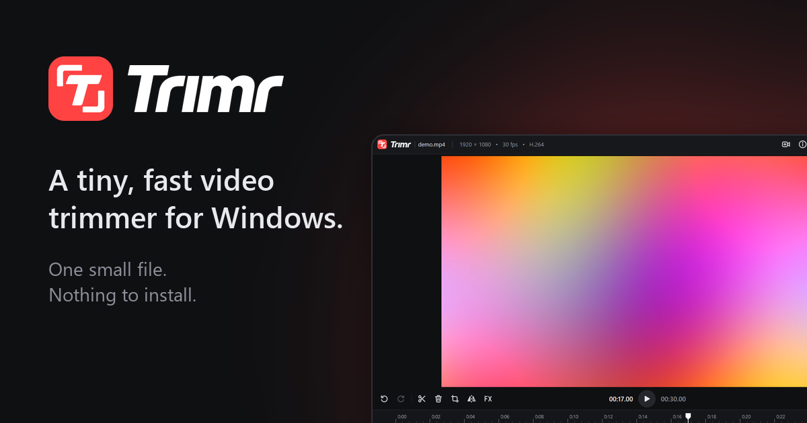

# Trimr

A tiny, fast video trimmer for Windows. Cut, crop, join and layer clips, add music, and export at the
source's quality. One small file, nothing to install.

**[Download Trimr.exe](https://github.com/DUCO-SPQR/trimr-app/releases/latest/download/Trimr.exe)**
&nbsp;·&nbsp; [Website](https://duco-spqr.github.io/trimr-app/)
&nbsp;·&nbsp; [All versions](https://github.com/DUCO-SPQR/trimr-app/releases)

Needs Windows 10 or 11 (64-bit). Trimr isn't signed, so the first time Windows may show
*Windows protected your PC*: click **More info**, then **Run anyway**.

This repository holds Trimr's download page and releases.
